# Pacifique Niyogushimwa

### Software Engineer · Full-Stack Developer · Network & IoT Specialist

*I build reliable software, connected systems, and practical technology solutions.*

---

## About Me

I'm an IT professional and software developer from Kigali, Rwanda. I build practical solutions across **software, networking, and IoT**, from backend APIs and databases to microcontrollers and network infrastructure.

I work across the full development lifecycle: analysis, architecture, implementation, testing, deployment, and maintenance. Right now I'm deepening my skills in **DevOps, cloud, and machine learning**.

| | |
|---|---|
| 📍 **Location** | Kigali, Rwanda |
| 🎓 **Education** | BTech in Information Technology, Rwanda Polytechnic (Musanze College) |
| 💼 **Current role** | IT Instructor, Muhanga Technical Center |
| 🎯 **Focus areas** | Backend development · Network engineering · IoT · DevOps · Machine Learning |

---

## What I Do

- **Full-stack and backend development:** REST APIs, authentication (JWT, role-based access), and database-driven applications
- **Database design:** relational modelling, normalization, schemas, and migrations
- **Networking and infrastructure:** TCP/IP, subnetting, routing and switching, VLANs, troubleshooting, Linux and Windows administration
- **IoT and embedded systems:** ESP32 and Arduino, sensor integration, Wi-Fi communication, monitoring and automation
- **Delivery:** Git workflows, CI/CD with GitHub Actions, and deployment to Netlify, Vercel, and Render
- **Data and ML:** data cleaning, exploratory analysis, feature engineering, and model training with scikit-learn

---

## Tech Stack

**Languages**

**Backend**

**Frontend**

**Databases**

**Networking and Systems**

**IoT and Embedded**

**DevOps and Tools**

**Data Science and ML**

---

## Featured Projects

| Project | What it does | Stack |
|---|---|---|
| [**Campus Security & Reporting System**](https://github.com/21paxon/csrs) | Centralized security and incident platform for Rwanda Polytechnic, Musanze College: anonymous reporting, emergency panic alerts, visitor and checkpoint management, audit logging | Node.js · Express · PostgreSQL · JWT |
| [**Bus Booking System**](https://github.com/21paxon/busbooking) | Full-stack platform for managing bus routes, schedules, and passenger reservations, with an admin dashboard | Java · Spring Boot · Angular · TypeScript · PostgreSQL |
| [**Hostel Management System**](https://github.com/21paxon/hms) | Android app with a REST backend for student registration and hostel room allocation | Kotlin · Retrofit · Node.js · PostgreSQL |
| [**USSD BMI Calculator**](https://github.com/21paxon/ussdbmi-app) | Menu-driven BMI calculator in English and Kinyarwanda, accessible from any basic phone | Node.js · Express · USSD Gateway |
| [**Machine Learning Practice**](https://github.com/21paxon/ML_Project) | Hands-on exploration of preprocessing, EDA, feature engineering, regression, and classification | Python · Pandas · NumPy · scikit-learn |

<b>Project highlights</b>

**Campus Security & Reporting System**
- Anonymous incident reporting and one-tap emergency alerts
- Role-based access control with JWT authentication
- Full incident tracking and audit trail

**Bus Booking System**
- Route and schedule management with passenger reservations
- Authenticated users and an administrative back office
- Angular front end consuming a Spring Boot REST API

**Hostel Management System**
- Student registration and room allocation from a mobile app
- Retrofit client integrated with a Node.js and PostgreSQL backend

**USSD BMI Calculator**
- Bilingual interactive menus (English and Kinyarwanda)
- Works on feature phones, with no smartphone or data plan needed

---

## Experience

**IT Instructor** · Muhanga Technical Center
*Muhanga, Rwanda · September 2025 – 2026*

- Taught software development, computer networking, and IT fundamentals through hands-on practice
- Mentored learners through programming exercises and team software projects
- Supported practical work in database management and network configuration
- Introduced Git and GitHub for collaborative development
- Helped learners troubleshoot technical problems and implement real IT solutions

---

## Education

| Qualification | Institution | Period |
|---|---|---|
| **BTech in Information Technology** | Rwanda Polytechnic, Musanze College | Sept 2026 – Present |
| **Advanced Diploma (A1) in Information Technology** | Rwanda Polytechnic | Completed June 2025 |

## Certifications

- Software Development, DTP
- Cybersecurity, DTP
- AI Career Essentials, ALX Africa
- EF SET English Certificate, B2 Upper Intermediate

---

## Currently Learning

- **DevOps:** CI/CD, GitHub Actions, Linux, deployment automation
- **Machine Learning:** predictive modelling and scikit-learn
- **Software Engineering:** system architecture, secure development, software quality
- **Cloud:** application hosting, infrastructure, and deployment practices

---

## GitHub Stats

---

## Let's Connect

I'm open to collaborating with developers, engineers, and organizations building practical solutions.

- 🌐 [Portfolio](https://pacifiqueniyogushimwa.netlify.app/)
- 💻 [GitHub](https://github.com/21paxon)
- 💼 [LinkedIn](https://linkedin.com/in/pacifique-niyogushimwa-b689033ab)
- ✉️ [niyogushimwapacifique6@gmail.com](mailto:niyogushimwapacifique6@gmail.com)
- 📸 [Instagram](https://instagram.com/__pacifique_/) · 🐦 [X (@21Paxon)](https://x.com/21Paxon)

**Engineering solutions. Building systems. Creating impact.**

